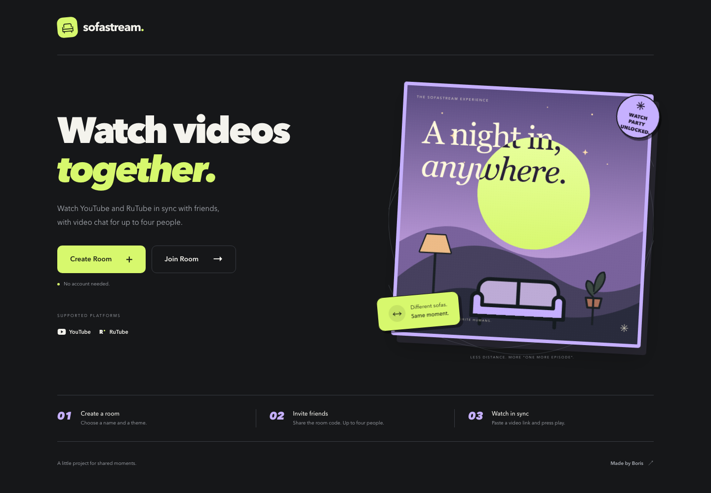
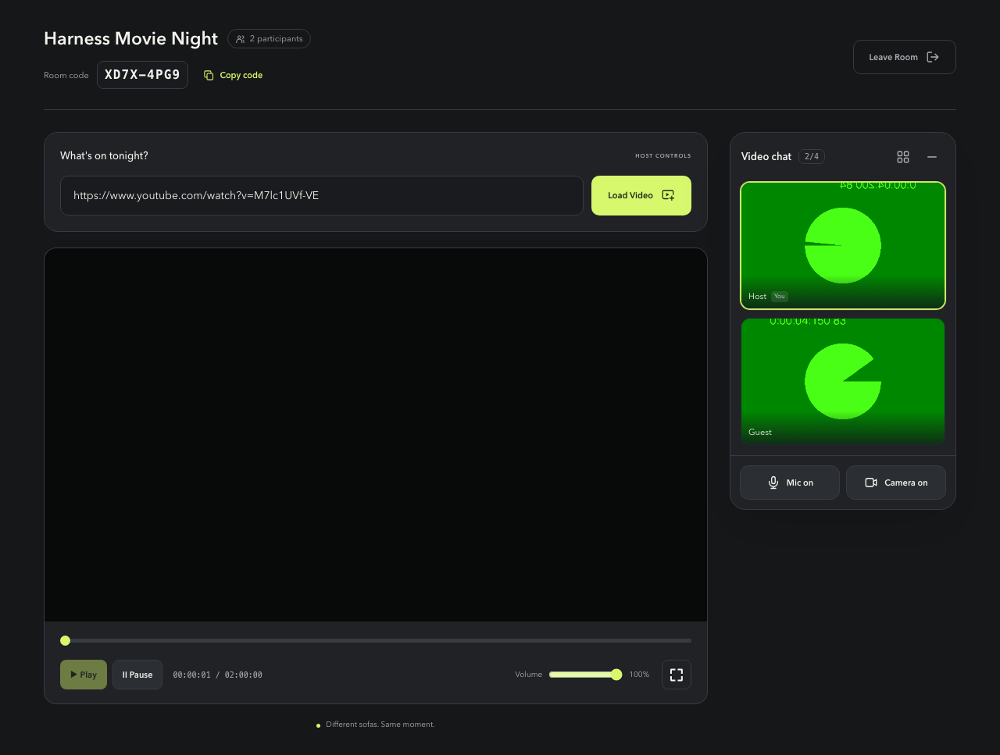
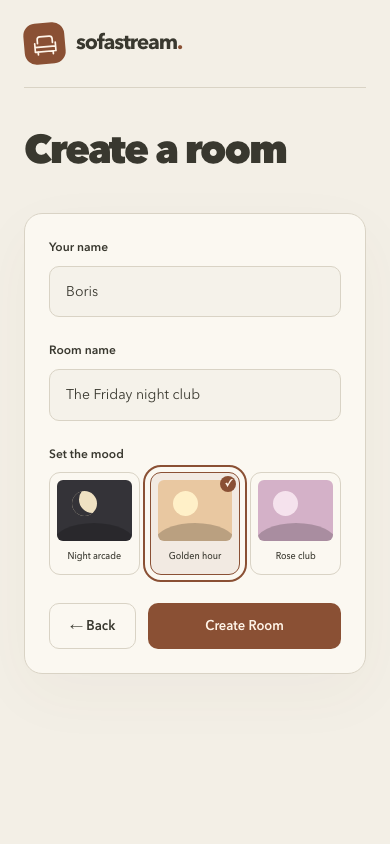
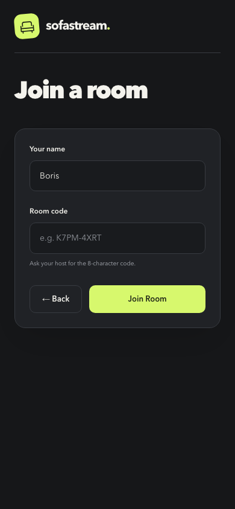

# 🛋️ <a href="https://sofastream.ru">SofaStream</a>

**SofaStream** — это современная веб-платформа для совместного просмотра видеоконтента в реальном времени, созданная с фокусом на пары, находящиеся на расстоянии, и дружеские компании.

В отличие от обычной трансляции экрана в мессенджерах, SofaStream обеспечивает **жесткую синхронизацию состояния плеера** у всех участников комнаты (воспроизведение, пауза, перемотка), компенсируя сетевые задержки и автоматически реагируя на буферизацию (падение скорости интернета) у отдельных пользователей.

**Ссылка для тестирования проекта - https://sofastream.ru** - [ВРЕМЕНО НЕ РАБОТАЕТ]

---

## 🎬 Скриншоты интерфейса

### Главная страница



### Комната совместного просмотра



Снимок комнаты сделан во время прогона Playwright с имитацией воспроизведения и камер.

### Создание комнаты и вход в мобильной версии

| Создание комнаты | Вход по коду приглашения |
| --- | --- |
|  |  |

---

## ✨ Ключевые возможности проекта

### 🖥️ Фронтенд (Frontend)
- **Vanilla JS & CSS3**: Легковесный клиентский интерфейс, работающий без тяжелых фреймворков.
- **Интегрированный Видео- и Аудиочат**: Реализован полноценный P2P-чат на базе **WebRTC** прямо поверх плеера (Room Chat) с возможностью включения/выключения камеры/микрофона, а также минимизации или полного скрытия панели чата.
- **Универсальный адаптер плееров**: Поддержка и синхронизация плееров **YouTube** и **RuTube** (включая автоматическое переключение типа плеера по ссылке).
- **Кастомные элементы управления**: Собственный красивый прогресс-бар, кнопки Play/Pause, тайм-код и полноэкранный режим с автоскрытием панели управления при неактивности.
- **Стилизация и темы оформления**:
  - `Warm Cozy` (Теплая и уютная домашняя тема).
  - `Princess Pink` (Нежная розовая тема со сверкающими динамическими блестками/глиттером).
  - `Midnight Dark` (Темная полночь для комфортного ночного просмотра).

### ⚙️ Бэкенд (Backend) & Архитектура
- **Clean Architecture & Domain-Driven Design (DDD)**:
  - **Rich Domain Model**: Логика синхронизации, управление участниками и выбор хоста инкапсулированы в `Aggregate Root` (`Room.cs`).
  - **Result Pattern**: Надежная обработка бизнес-ошибок с использованием объекта `Result` вместо исключений.
  - **Domain Events**: События (смена видео, изменение состояния воспроизведения) транслируются клиентам в реальном времени.
- **CQRS на уровне БД (Hybrid ORM)**:
  - **Entity Framework Core**: Применяется для команд (запись), гарантируя целостность транзакций и удобство работы с миграциями PostgreSQL.
  - **Dapper**: Используется для запросов (быстрое чтение состояния комнаты) с целью обеспечения максимального быстродействия.
- **SignalR (WebSockets)**: Реализует двусторонний обмен данными, синхронизацию плеера и проброс WebRTC-сигналов (SDP offer/answer, ICE candidates) между клиентами.
- **Безопасность и жизненный цикл**:
  - Настройка заголовков CSP и строгая песочница (`sandbox`) для iframe-плееров во избежание XSS/Clickjacking.
  - **Smart Disconnect**: Автоматическое отслеживание разрывов соединений в SignalR Hub с переназначением прав хоста, если лидер покинул сессию.
  - **Автоочистка ресурсов**: Каскадное удаление комнат и участников при отключении последнего пользователя, что предотвращает накопление мусорных данных в БД.

---

## 🛠️ Стек технологий

- **Backend**: C# 14, .NET 10, ASP.NET Core (Web API, SignalR, Entity Framework Core, Dapper)
- **Database**: PostgreSQL (Npgsql)
- **Frontend**: HTML5, Vanilla CSS3 (Custom Themes, Glassmorphism, Animations), Vanilla JS (WebRTC PeerConnection API, YouTube/RuTube Iframe API, SignalR JS Client)
- **Environment**: Docker Compose

---

## 🗺️ Текущий статус проекта (Roadmap)

- [x] **Domain Layer**: Сущности `Room`, `RoomParticipant` и `Video`, паттерн Domain Events.
- [x] **Application Layer**: Логика CQRS команд и запросов, паттерн Result.
- [x] **Infrastructure Layer**: Настройка PostgreSQL, реализация репозиториев и Dapper-запросов.
- [x] **Presentation Layer**: SignalR Hubs (`RoomHub`), глобальная обработка ошибок и REST-контроллеры.
- [x] **Frontend Client**: Реализация интерфейса, интеграция SignalR-клиента, синхронизация плееров и компенсация задержек.
- [x] **WebRTC Video Chat**: Живой видео- и аудиочат для участников комнаты.
- [x] **Themes Support**: Поддержка смены визуальных тем (`Warm Cozy`, `Princess Pink`, `Midnight Dark`).

---

## 🚀 Разработка и проверки

В [`src/`](src/) находятся API, остальные проекты .NET и фронтенд. В [`tests/`](tests/) лежат оба тестовых проекта .NET, тесты JavaScript и браузерные сценарии Playwright.

Выполняйте команды из папки с `SofaStream.sln`. Для локального запуска нужны .NET SDK из `global.json`, Docker Compose и Python 3.

```bash
docker compose -f compose.dev.yml up -d --wait
ConnectionStrings__DefaultConnection="Host=localhost;Port=${SOFASTREAM_DB_PORT:-5433};Database=sofa_dev;Username=sofa_dev;Password=sofa_local_only" \
  dotnet run --project src/SofaStream.Api --launch-profile http
```

В другом терминале запустите фронтенд и откройте [localhost:8000](http://localhost:8000).

```bash
python3 -m http.server 8000 --bind 127.0.0.1 --directory src/Frontend
```

Ctrl+C останавливает процессы API и фронтенда. Команда `docker compose -f compose.dev.yml down` останавливает локальную базу с сохранением данных.

Если раньше запускали `npm run dev`, прежняя база хранится в томе `sofastream-dev-…_dev_data`. Посмотрите имя тома через `docker volume ls --filter label=com.docker.compose.volume=dev_data` и задайте `COMPOSE_PROJECT_NAME` равным его имени без суффикса `_dev_data` перед запуском и остановкой Compose. Для другого порта базы экспортируйте `SOFASTREAM_DB_PORT` перед запуском Compose и API.

### Тесты

- `dotnet test tests/SofaStream.Tests` запускает быстрые .NET-тесты. `dotnet test SofaStream.sln` включает интеграционные тесты, которые сами поднимают контейнер PostgreSQL.
- `node --test tests/frontend/*.test.mjs` запускает тесты JavaScript. Нужен Node.js 22 или новее.
- Для браузерных сценариев выполните `dotnet restore SofaStream.sln --locked-mode`, `npm ci` и `npx playwright install chromium`. Освободите порты API и фронтенда 5063 и 8000. Запустите отдельную базу для тестов, затем Playwright.

```bash
SOFASTREAM_DB_PORT=5434 docker compose -p sofastream-e2e -f compose.dev.yml up -d --wait
npx playwright test
docker compose -p sofastream-e2e -f compose.dev.yml down
```

Playwright запускает API и фронтенд. Сценарии проверяют синхронизацию с управляемым плеером. Настоящие YouTube/RuTube и звонки между разными сетями проверяются вручную.

Контекст проекта собран в [архитектуре](docs/architecture.md), [дизайне](docs/design.md) и [инструкции для Codex](AGENTS.md).
